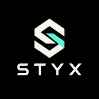
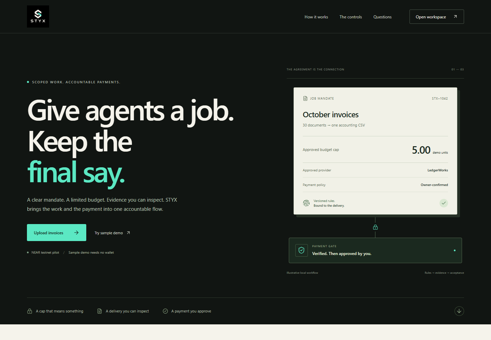
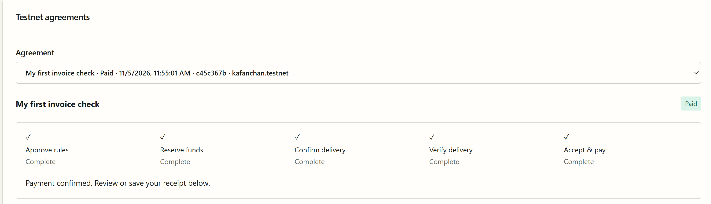
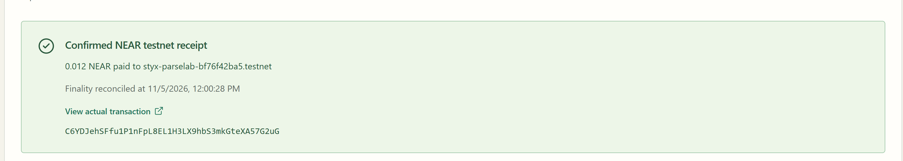
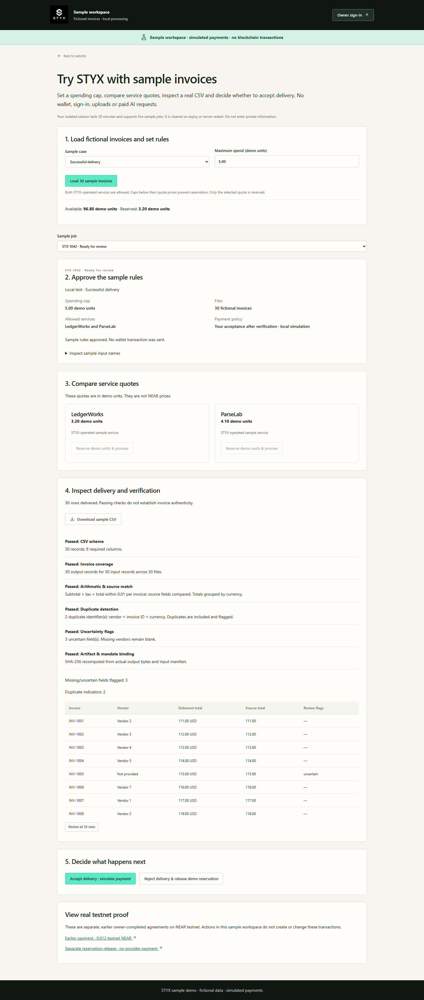
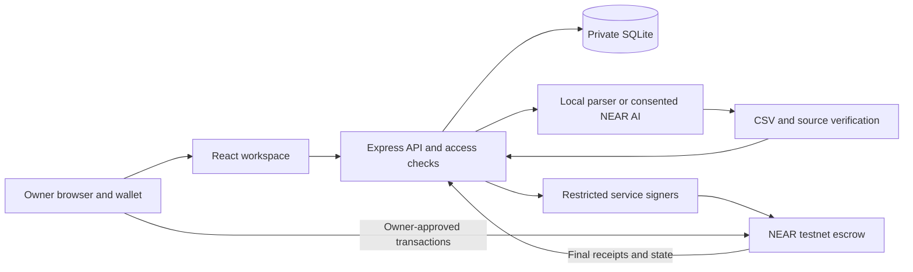

<div align="center">
  

# STYX

**Delegate the work. Inspect the evidence. Keep control of payment.**

An owner-controlled invoice processing workspace with scoped service roles, independently checked CSV deliveries, and wallet-approved settlement on NEAR testnet.

[Live app](https://usestyx.xyz) · [Try sample demo](https://usestyx.xyz/try-demo) · [Watch demo](https://youtu.be/7t0hImAfEIY) · [Quick start](#quick-start) · [Product tour](#product-tour) · [Testnet proof](#real-testnet-proof) · [Architecture](#architecture) · [Documentation](#documentation)

</div>

## What is STYX?

An assistant can prepare an accounting file, but that should not give it permission to spend an owner's entire budget or pay for an unchecked result.

STYX connects a specific job to explicit rules: which service can perform it, the maximum allocation, the recipient, expiry, and the evidence required before acceptance. The owner reviews those rules, checks the delivery, and authorizes payment. Service roles do not receive the owner's wallet keys.

The current use case is **structured invoices to accounting CSV**. Upload JSON or CSV invoices, choose local parsing or an explicitly authorized NEAR AI request, inspect verification results, then prepare a separately priced NEAR testnet agreement. The owner can accept a verified delivery or release a reservation without paying the provider.



## Watch the demo

[Watch the narrated STYX walkthrough on YouTube](https://youtu.be/7t0hImAfEIY) (2 minutes 30 seconds).

Follow the public sample from spending rules and service quotes to CSV review, simulated acceptance, and rejection of failed work. The blockchain-proof section shows separate, earlier owner-completed NEAR testnet transactions. Sample payments are simulated; they do not send NEAR.

## At a glance

| Area | Current implementation |
| --- | --- |
| Input | Structured JSON/CSV invoices; no PDF or OCR |
| Processing | Deterministic local parsing, or optional NEAR AI with sharing and API-cost consent |
| Review | Actual accounting CSV, source comparisons, coverage, arithmetic, duplicate and uncertainty checks |
| Owner control | Versioned mandates, spending caps, recipients, expiry and wallet confirmation |
| Service roles | Distinct buyer-agent, provider and verifier identities with restricted server-side keys |
| Settlement | Actual NEAR testnet escrow, reservations, delivery, attestation, owner release and final reconciliation |
| Recovery | Persisted signing intents, interrupted-request reconciliation and reservation release |
| Local practice | Explicit synthetic scenarios with demo units, separate from NEAR |
| Storage/access | Private SQLite files, password sessions, owner/viewer roles and workspace isolation |
| Hosting | Ubuntu ARM64 VPS, Docker and Caddy HTTPS; domain/DNS managed by Vercel |
| Status | Working testnet pilot; independent review and mainnet launch remain ahead |

**The owner workspace requires sign-in** because it contains private owner records. Judges can open [Try sample demo](https://usestyx.xyz/try-demo) without credentials, a wallet, uploads or paid AI. Each visitor receives a separate temporary workspace using fictional invoices and simulated payments. The public landing-page illustration is also a simulation, not payment evidence.

## Product tour

| Screen | Purpose |
| --- | --- |
| Landing | Understand the product and try an illustrative approval flow |
| Overview / Testnet escrow | Prepare evidence, compare service quotes, review agreements and inspect settlement |
| Invoice deliveries | Find saved jobs, source files, artifacts and verification reports |
| Delivery review | Search invoice rows, compare fields, inspect flags and download files |
| Providers | Inspect service adapters and local practice pricing |
| Activity | Inspect persisted job and policy events |
| Local testing | Create explicit sample success, timeout, invalid-output and policy-failure cases |
| Settings | Manage workspace settings and integration readiness |

### Completed testnet agreement

This owner-supplied screenshot shows an **earlier completed ParseLab testnet agreement**. All five stages are complete. It is a historical run, not a new submission or mainnet payment.



### Confirmed network receipt

The matching receipt records **0.012 testnet NEAR** paid to `styx-parselab-bf76f42ba5.testnet`. Its actual transaction is linked below. No passwords or private keys are included in these reviewed captures.



### Try the public sample workspace

Open **[usestyx.xyz/try-demo](https://usestyx.xyz/try-demo)** or choose **Try sample demo** on the homepage. Set a cap, load 30 fictional invoices, approve the rules, compare quotes, review the actual CSV and choose simulated acceptance or reservation release. An arithmetic-failure case demonstrates blocked acceptance.

The banner always identifies simulated payments. Demo units are never converted to NEAR; separate links show earlier real testnet transactions. Sessions last 30 minutes, support five jobs, and are discarded on expiry or server restart. No owner login, wallet, file upload or paid model is available in this mode. [Design and limits](docs/SAMPLE_DEMO.md).



## How it works

1. **Prepare evidence.** Upload structured invoices and choose local parsing or consent to configured NEAR AI processing.
2. **Inspect delivery.** Review the real CSV and checks against the source. A passing report is evidence, not proof of authenticity.
3. **Compare quotes.** Choose a configured service and set a separate maximum spend in testnet NEAR.
4. **Approve the agreement.** Review roles, recipient, quote, cap, expiry and verification requirements; confirm the owner action in the wallet.
5. **Reserve and deliver.** The buyer-agent reserves the agreed amount, the provider submits delivery, and the verifier records its attestation.
6. **Accept or release.** The owner decides whether to pay. A reservation release returns funds to available escrow; a wallet withdrawal is separate.
7. **Reconcile.** STYX checks final transaction receipts and contract state before displaying a confirmed payment receipt.

### Three separate concepts

| Mode | Money / processing | What it establishes |
| --- | --- | --- |
| Local practice | Synthetic inputs and demo units; no wallet transfer | Exercises application rules and review screens |
| NEAR testnet | Actual transactions using test NEAR | Demonstrates contract behavior and wallet approval, without commercial payment value |
| Optional NEAR AI | External inference with potentially real API charges | Produces an extraction for independent checks; cannot approve owner payment |

LedgerWorks and ParseLab are currently **STYX-operated services**, not an independent commercial marketplace. Testnet quotes are configured separately from local demo-unit prices.

## Real testnet proof

Current keyed-storage contract: [`styx-contract-bf76f42ba5.testnet`](https://testnet.nearblocks.io/address/styx-contract-bf76f42ba5.testnet).

Reviewed deployment code hash: `Fvxj2r1j4k9fJXpPzVDGUoeRQ8SNZWHfsfbJ1Dsf6fZW`.

| Verified owner journey | Final state | Network evidence |
| --- | --- | --- |
| ParseLab delivery, attestation and owner payment | `Paid`; 0.012 testnet NEAR | [Payment transaction](https://testnet.nearblocks.io/txns/C6YDJehSFfu1P1nFpL8EL1H3LX9hbS3mkGteXA57G2uG) |
| Separate reservation-release journey | `Refunded`; no provider payment for that agreement | [Reservation-release transaction](https://testnet.nearblocks.io/txns/ARcXLW2RA5NDnQVKidWjP3WEdo5VgUjKsEzthcUpqNoE) |

Both transactions were checked for `FINAL` success, zero failed receipts and the expected contract state. They are **different agreements**, not successive states of one payment. [Machine-readable owner acceptance evidence](docs/verification/keyed-owner-acceptance.json) records the November 5 checks.

The earlier whole-map contract and its historical funds/receipts were preserved. The keyed-storage replacement followed a reproduced callback gas failure at 100 stored jobs. See [design and measured limits](docs/CONTRACT_KEYED_CANDIDATE.md), [deployment evidence](docs/verification/keyed-testnet-deployment.json), and [verification history](docs/verification/RESULTS.md). A sandbox benchmark is not production capacity certification.

## Quick start

### Requirements

- **Node.js 24+** and npm, for built-in `node:sqlite` support.
- A modern browser.
- Rust only to build/test the contract.

```sh
git clone https://github.com/vickman787/styx.git
cd styx
npm ci
npm run dev
```

Open **http://127.0.0.1:4173**. A fresh checkout needs no secrets for local practice. The server binds to loopback, and SQLite creates private application data under ignored `data/`.

### Complete a local case

1. Open **http://127.0.0.1:4173/testing**.
2. Start **Successful delivery**. It creates a job with 30 synthetic invoice files and a 5.00 demo-unit cap.
3. Review and approve the mandate, then select a service quote.
4. Inspect the delivered CSV, original-field comparisons and verification report.
5. Accept the delivery and inspect the local receipt.
6. Try a timeout or invalid-output case to inspect correction and cancellation.

This exercises the local ledger, without transferring NEAR. A fresh install does not contain hosted owner history or credentials. The default `/app` opens the testnet console with setup guidance if no deployment is configured.

### Use your own invoices

Open `/testnet#upload`, set a delivery name, upload JSON/CSV, and choose **Local structured parsing**. Evidence preparation can be tried without a deployed contract. Signing/payment need separately configured testnet accounts.

```json
{
  "invoice_id": "SAMPLE-001",
  "vendor": "Example Studio",
  "date": "2026-11-01",
  "currency": "USD",
  "subtotal": "100.00",
  "tax": "10.00",
  "total": "110.00"
}
```

JSON accepts one invoice or an array. CSV uses these same headers, with optional `notes`. Use nonnegative decimal strings with at most two decimal places, YYYY-MM-DD dates and three uppercase currency letters. A missing vendor must be an empty string. Limits: **1 MB per file, 5 MB per job, 100 files, 1,000 rows per input**. PDF, images, OCR, encrypted-document parsing and currency conversion are unsupported.

## Configure NEAR testnet

Fresh installations must provision their own contract and distinct service accounts. **No deployed signing keys are distributed.** Owner keys remain in the connected wallet.

1. Follow the [contract guide](contracts/styx/README.md) and [testnet setup](docs/NEAR_TESTNET.md).
2. Deploy reviewed WASM to a named `.testnet` account and configure its code hash.
3. Configure distinct buyer-agent, verifier and provider identities with restricted keys.
4. Keep private configuration outside version control, such as `data/near-testnet/app.env`.
5. Restart, open `/testnet`, and check chain/code readiness before signing.
6. Connect a testnet wallet and review each owner action. Escrow funds and storage credit are separate.

See [live testing](docs/TESTNET_LIVE.md) and [keyed acceptance](docs/KEYED_WALLET_ACCEPTANCE.md). Historical documents retain dated observations; the newer proof table above records successful ParseLab acceptance.

## Optional NEAR AI

Local parsing does not call a model. External extraction requires server opt-in, an API key/model and explicit per-job data-sharing and cost consent. Corrections can make another paid request. API charges are separate from testnet escrow and demo units.

One actual synthetic-invoice inference passed independent checks: [recorded evidence](docs/verification/ai-live-check.json). This is not a quality certification or cryptographic model/TEE attestation. Read [NEAR AI setup and data flow](docs/NEAR_AI.md).

## Architecture



| Layer | Technology | Responsibility |
| --- | --- | --- |
| Frontend | React 19, TypeScript, Vite 8, CSS | Forms, evidence review, wallet handoff and receipts |
| Server | Node.js 24, Express 5, Zod | Access, policy checks, jobs and transaction intents |
| Storage | Built-in SQLite | Private files, sessions, mandates and reconciliation records |
| Contract | Rust / NEAR | Escrow, role boundaries, reservations, verification gates and transfers |
| Wallet | NEAR Wallet Selector / Meteor | Owner-controlled testnet signing |
| Processing | Local adapters; optional NEAR AI | Extraction followed by independent checks |
| Hosting | Docker on Ubuntu, Caddy | Single persistent application process and HTTPS |
| Domain | Vercel DNS | Points the hostname to the VPS; no Vercel Functions hosting |

Invoice files stay offchain; the contract records agreement/delivery identifiers and hashes needed by its rules. The server, database and verifier are trusted components. STYX does not claim trustless document verification.

## Configuration and operations

`.env.example` lists settings without credentials. The npm commands load ignored `data/near-testnet/app.env` and `data/near-ai.env` if present. Root `.env` is not loaded automatically; use shell variables or explicitly invoke Node with `--env-file=.env`.

| Setting | Purpose |
| --- | --- |
| `PORT`, `HOST` | Listener; local default 4173 and loopback |
| `STYX_DB` | Private SQLite path |
| `STYX_AUTH_MODE` | Local owner mode or password access |
| `STYX_APP_ORIGIN` | Exact expected browser origin; HTTPS for public hosting |
| `NEAR_CONTRACT_ID`, `NEAR_CONTRACT_CODE_HASH` | Reviewed testnet deployment |
| `NEAR_*_ACCOUNT_ID`, `NEAR_*_PRIVATE_KEY` | Distinct restricted service identities; server-side only |
| `NEAR_*_PRICE_NEAR` | Explicit configured quotes |
| `NEAR_AI_ENABLED`, `NEAR_AI_API_KEY`, `NEAR_AI_MODEL` | Optional external processing |
| `STYX_B2_*`, `STYX_BACKUP_KEY_FILE` | Optional private encrypted backups |

Public hosting requires password access and operator-provisioned users; no default password exists. The VPS launcher validates its profile. Use the [VPS guide](docs/VPS_DEPLOYMENT.md), [access guide](docs/ACCESS.md) and [operations guide](docs/OPERATIONS.md). Keep one authoritative SQLite writer.

Online backup, restore-to-new-database, recovery rehearsal, private B2 encryption/upload and a one-shot backup runner are implemented. Scheduling, alerts and credentials require separate setup: [backup runner](docs/BACKUP_RUNNER.md), [Backblaze](docs/BACKBLAZE.md), [deployment checks](docs/DEPLOYMENT_CHECK.md).

## Development and verification

| Command | Purpose |
| --- | --- |
| `npm run dev` | Local Express/Vite server |
| `npm run typecheck` | TypeScript checks |
| `npm run lint` | ESLint checks |
| `npm test` | Policy, access, recovery, wallet and integration tests |
| `npm run build` | Typecheck and production frontend build |
| `npm run check:production` | Isolated offline production-install smoke |
| `npm start` | Serve the production build |
| `npm run test:browser` | Playwright against a separately running app |
| `npm run test:contract` | Rust engine tests |
| `npm run test:contract:sdk` | Optional native SDK checks; needs native compiler dependencies |

Browser tests create jobs: use a dedicated database, never the hosted owner workspace. Install Chromium with `npx playwright install chromium`. WASM/VM and scale checks need additional tooling documented in [contract testing](docs/CONTRACT_TESTING.md).

Recorded validation includes the application suite, real owner payment and reservation-release acceptance, keyed-contract VM safety checks and a 100-job sandbox benchmark. [Verification results](docs/verification/RESULTS.md) preserve dates and scope. Mocks, native tests, VM measurements and testnet transactions establish different things; none replaces an independent audit.

## Boundaries and remaining work

- **Testnet only:** mainnet and commercial payments are disabled.
- **Owner authority:** models and service signers cannot authorize owner funding or payment release.
- **Verification limits:** source matching and arithmetic do not establish authenticity or business truth.
- **Trusted components:** server, verifier and operator remain in the trust model.
- **Limited marketplace:** both configured services are STYX-operated.
- **Explicit recovery:** reconcile interrupted submissions before retrying; an error screen does not prove no transaction was sent.
- **Private owner workspace:** guest demo sessions have separate in-memory databases and cannot access owner APIs.
- **Submission media:** the [narrated video is published on YouTube](https://youtu.be/7t0hImAfEIY); sample screens label simulated payments and link separately to actual testnet proof.
- **Further validation:** independent security review, dependency review, broader user testing and operational/load checks remain ahead.

Private databases, environment files, wallet keys, logs, raw recordings and unreviewed historical screenshots are excluded. Only selected reviewed screenshot copies are published. [Design provenance](docs/design/SOURCES.md) records the original Canva logo source.

## Documentation

- [Build specification](STYX_BUILD.md), [implementation history](IMPLEMENTATION_STATUS.md), [remaining queue](BUILD_QUEUE.md)
- [Local testing](docs/LOCAL_TESTING.md), [delivery review](docs/DELIVERY_REVIEW.md), [demo outline](docs/DEMO.md)
- [Security assumptions](docs/SECURITY.md), [provider protocol](docs/PROTOCOL.md)
- [Live testnet guide](docs/TESTNET_LIVE.md), [contract README](contracts/styx/README.md), [keyed design](docs/CONTRACT_KEYED_CANDIDATE.md)
- [NEAR AI](docs/NEAR_AI.md), [workspace access](docs/ACCESS.md), [VPS deployment](docs/VPS_DEPLOYMENT.md)

## Hackathon context

Prepared for NEAR HACKATHON; recommended tracks are **AI Security & Defense** and **Agent Economy**. STYX demonstrates bounded agent-service spending tied to delivery evidence and owner approval.

Dated evidence includes work before November 1, 2026. Eligibility and treatment of prior work must follow the organizers' rules; STYX does not claim all code was written within the competition window. The [video walkthrough](https://youtu.be/7t0hImAfEIY) is available; the X demo-post and submission links will be added when they exist.
